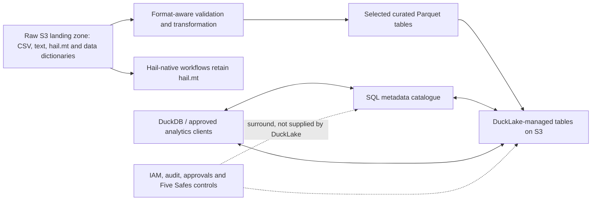

# DuckLake as a Data-Access Model: Rapid Feasibility Assessment

**Prepared by:** the researcher  
**Date:** 27 July 2026  
**Decision addressed:** Is DuckLake promising enough to justify a bounded the target environment pilot?  
**Assessment boundary:** Current raw-file data lake on S3 versus plain Parquet and
DuckLake-managed Parquet. This is not a production architecture decision.  
**Evidence base:** Local functional testing only (§4). No S3, IAM, concurrency or backup/restore
evidence.

## Executive summary

**Finding:** DuckLake is technically credible as a managed-table layer over curated Parquet tables. This assessment addresses the architectural problem of moving from raw-file access
on S3 towards consistent, versioned shared tables. The local micro-experiment confirms basic
mechanics: the same analytical result from one synthetic dataset represented as CSV, plain Parquet
and DuckLake, followed by a managed update, historical read and successful reopen. It is a
**functional comparison, not a performance benchmark**.

**Recommendation:** Before committing pilot infrastructure, select a representative the target environment
workload and confirm that these capabilities provide material value beyond a controlled Parquet
pipeline. The report identifies the relevant architectural limitations but, without evidence from
a representative internal workload, does not yet establish their operational materiality. If the
value is confirmed, run the bounded pilot described in §7.

**Key qualification:** Parquet supplies most storage-format benefits; DuckLake adds managed table
state, transactions and history but introduces another sensitive, stateful component to operate.
It should manage selected curated tables rather than replace the raw-data lake. The evidence does
not support production adoption.

## 1. Problem and intended outcome

The assessment starts from a **data lake of raw, heterogeneous-format data files on S3**. This
preserves source fidelity and ingestion flexibility, but shared analytical use can expose
limitations:

- consumers may repeatedly interpret types and format-specific options;
- teams may need their own processes to keep data structures, updates and versions consistent;
- query efficiency varies by physical format; and
- users may need to find data through file locations rather than named, managed tables.

These are expected architectural limitations, not measured evidence that every the target environment dataset is
problematic. A representative workload must establish their operational materiality.

Current accepted inputs have different roles:

| Raw S3 input | Intended treatment in this assessment |
|---|---|
| CSV | Candidate tabular input for controlled validation and conversion to Parquet |
| Text (`.txt`) | Candidate tabular input if delimited; irregular or free-form content needs format-specific parsing |
| Hail MatrixTable (`hail.mt`) | Retain as the Hail-native genomics representation; consider only selected relational or derived outputs for Parquet/DuckLake |
| Excel | Treat as a data dictionary supplying column definitions, meanings and validation rules, not as the main analytical dataset |

The assessment question is whether controlled transformation of selected tabular data to
DuckLake-managed Parquet adds enough metadata, transactions and history beyond plain Parquet to
justify a bounded pilot. The intended outcome is a next-step decision, not a production
architecture or migration plan.

## 2. Data lake versus data lakehouse

A data lake prioritises flexible file storage. A lakehouse retains object storage while adding
managed-table behaviour. The current-state column below distinguishes confirmed facts from
capabilities that this rapid assessment did not establish.

| Dimension | Current raw-file layer | Data lakehouse | DuckLake relevance |
|---|---|---|---|
| Storage | Heterogeneous raw files on S3, including CSV, text, `hail.mt` and Excel data dictionaries | Curated analytical data commonly stored in open columnar files | Manages selected Parquet tables while raw sources remain available |
| Table metadata and schema | Current catalogue and schema-management mechanisms were not established | Central table metadata and controlled schemas | Records schemas, files and statistics in a SQL catalogue |
| Updates, history and concurrency | Current mechanisms were not established | Transactional updates, table versions and coordinated writers | Provides snapshots, time travel and conflict handling |
| Query efficiency | Depends on physical format and layout; not measured here | Columnar reads and metadata-based pruning | Most storage benefits come from Parquet; catalogue statistics can add file pruning |
| Governance | Existing the target environment controls remain applicable; their implementation was not assessed | Still depends on platform governance and access controls | Relies on separate catalogue and storage permissions |
| Operations | Current ownership and recovery arrangements were not assessed | Catalogue and data require coordinated operation | Adds catalogue ownership, monitoring and recovery obligations |

The comparison separates two decisions:

1. **Raw formats to plain Parquet:** standardise selected analytical data and improve its physical
   representation.
2. **Plain Parquet to DuckLake-managed Parquet:** add managed table state, transactions and
   reproducible versions.

Use a controlled Parquet pipeline if physical consistency is sufficient. Consider DuckLake only
when a representative workload demonstrates material value from shared table state, history or
writer coordination. Other lakehouse formats, including Apache Iceberg and Delta Lake, were
outside this one-week assessment; their exclusion does not imply DuckLake is superior.

## 3. DuckLake architecture and relevance

DuckLake stores table data as Parquet and table metadata—including schemas, files, statistics and
snapshots—in a SQL catalogue. It therefore adds managed table state without replacing
object-storage data or the surrounding governance controls.

The catalogue should follow the workload. Current DuckLake guidance limits a DuckDB-backed
catalogue to a single client. For concurrent multi-user access, PostgreSQL is the documented stable
catalogue option, subject to an approved owner and operating model.

DuckLake v1.0 was announced on 13 April 2026, with deletion vectors still identified as
experimental. Stable documentation, active development and tests across supported catalogue
backends are positive pilot signals, but the release is recent and project-authored maturity claims
do not establish suitability for the target environment. The current assessment therefore relies on supported
core features and treats production readiness as unproven.

## 4. Functional comparative micro-experiment

The experiment compared functional behaviour—not performance—using the same 600-row synthetic
dataset as raw CSV, plain Parquet and a DuckLake-managed table.

**Test environment:** Local M4/ARM64 environment, Python 3.13, DuckDB 1.5.5 and DuckLake extension
build `d8a1881e`, using local storage. DuckDB 1.5.5 supports the DuckLake v1.0 specification; the
extension itself has no tagged release version and was resolved at runtime rather than pinned by
the dependency lock.

| Capability | Result |
|---|---|
| Analytical equivalence | The same aggregate result was returned from CSV, plain Parquet and DuckLake |
| Managed storage | DuckLake created external Parquet data under catalogue management |
| Transactions and history | An update created a new snapshot and time travel returned the earlier value |
| Persistence | The updated table remained correct after closing and reopening the catalogue |

This evidence supports the core single-client mechanics only. It does not test S3, IAM, concurrent
users, production volume, performance, audit, backup/recovery, failure modes or the target environment
integrations. Reproduction commands, locked Python dependencies, detailed results and the runtime
extension-version limitation are recorded in the
[micro-experiment README](poc/README.md).

## 5. Feasibility assessment

| Criterion | Assessment | Evidence and implication |
|---|---|---|
| Problem fit | **Potentially favourable** | DuckLake addresses shared-table metadata, controlled changes and history. Confirm these are real priority problems, rather than assuming heterogeneous raw files automatically justify a new layer. |
| Lakehouse value | **Additional capability confirmed; value unproven** | Transactions, snapshots, schema management and catalogue-level file pruning are additional value. Compression and in-file selective reads mainly come from Parquet. |
| Data path | **Mechanically demonstrated** | Local CSV-to-Parquet ingestion preserved the tested result. Real schema variation, validation, incremental loads and migration effort remain unknown. |
| Platform fit | **Documented compatibility; environment untested** | S3-compatible storage is documented, but S3/network behaviour and compatibility with SageMaker, platform applications, Hail and actual user paths were not tested. |
| Governance fit | **Unresolved; owner validation required** | DuckLake does not implement access control. Catalogue metadata can itself be sensitive, and snapshot retention can conflict with erasure requirements. Separate catalogue/storage controls and a retention policy require owner validation. |
| Operational fit | **Unresolved; operating model required** | The local test used a DuckDB catalogue, while a multi-user PostgreSQL catalogue would add an untested stateful service. Backup consistency, recovery, monitoring, ownership and support remain to be designed. |
| Maturity | **Supports a bounded pilot only** | v1.0, stable documentation, active upstream development and cross-backend test configurations support a pilot. The release is recent, some capabilities remain experimental, and there is limited evidence here of production operation in a comparable governed environment. |

These qualitative assessments are not a production-readiness score. The unresolved issues should
be addressed in sequence: confirm workload value, then governance and ownership, and finally—if
those gates pass—run the bounded S3 pilot.

## 6. Key risks and conditions

The following risks define the controls and evidence required for a bounded pilot and any later
adoption decision.

| Risk | Why it matters | Required condition |
|---|---|---|
| Retention and erasure | Deleted rows remain available through historical snapshots until expiry and file cleanup | Define snapshot retention, erasure outcomes and evidence of physical removal |
| Sensitive catalogue metadata | Names, counts, paths and column statistics may disclose study or cohort information | Enforce and audit separate least-privilege catalogue and S3 access |
| Plain Parquet may be sufficient | DuckLake adds avoidable operational state if only format consistency is needed | Demonstrate material need for transactions, shared table state or history |
| Catalogue/data consistency | Metadata and object data must be backed up and restored to a coherent point | Test clear failure behaviour and coordinated recovery |
| Migration complexity | Real files may contain schema drift, mixed encodings and lineage requirements | Validate one representative ingestion path before wider adoption |

## 7. Recommendation and next step

Hold a short scoping conversation with the study sponsor and platform owner before requesting
pilot infrastructure. Resolve four decision gates:

1. **Workload and value:** Which representative workload makes the documented raw-file
   limitations material, and would validated Parquet be sufficient? A dataset is a candidate for
   DuckLake management when it has multiple consumers, needs controlled updates, and needs
   reproducible history that file and pipeline conventions alone do not provide. A dataset needing
   only a consistent analytical format belongs in a controlled Parquet pipeline instead. On that
   test, candidate workloads are a periodically refreshed curated cohort table and a shared
   reference or mapping table. A Hail-derived relational output could also qualify, but choosing it
   would require deliberately widening the pilot outline below, which covers tabular data only
   (see §3).
2. **Governance:** Can acceptable retention/erasure rules and separate metadata/data access
   boundaries be defined?
3. **Ownership and operations:** Is there an accountable owner and support model for the catalogue,
   S3 paths, audit, concurrency and recovery?
4. **Decision evidence:** What result would justify a DuckLake pilot, favour plain Parquet, or stop
   the exploration?

Use a controlled Parquet pipeline if the need is only format consistency. If managed table state
and history provide material additional value and the governance/ownership gates are viable,
proceed to a bounded pilot after the required the target environment access is available.

### Conditional pilot outline

- Use one non-sensitive synthetic tabular dataset, retaining its source form, plain Parquet and
  DuckLake-managed Parquet for comparison.
- Use an approved S3 sandbox and one approved analytics path.
- Keep the catalogue single-client unless a multi-user requirement and supported PostgreSQL
  service are confirmed.
- Test data correctness, schema/snapshot behaviour, retention and expiry, separate access roles,
  concurrency where relevant, and recovery from missing or corrupt catalogue/data files.
- Require material workflow value beyond plain Parquet at acceptable operational complexity.

Stop if the pilot cannot meet the access, erasure or recovery requirements, lacks an accountable
owner, or adds no material value beyond the physical format change.

The [source register](source-register.md) distinguishes documented capabilities, local evidence,
working assumptions and unresolved internal facts.
